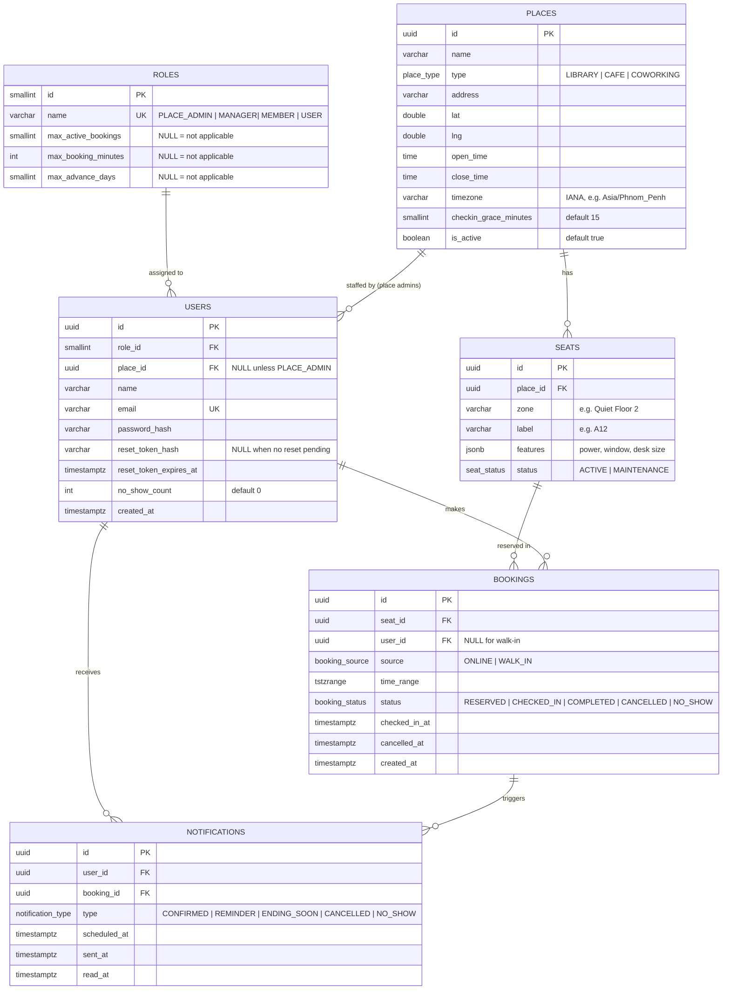

# Database ERD

Source of truth for the schema. Any schema change must update this file, the TypeORM entity, and a migration in the same PR.

**Database:** PostgreSQL (extension `btree_gist`). **Tables:** 6 (`roles`, `users`, `places`, `seats`, `bookings`, `notifications`).

## 1. Diagram



## 2. Roles

| Role | Meaning | Place scope |
|---|---|---|
| `SUPER_ADMIN` | Manages the whole platform and all places | None (`users.place_id` is `NULL`) |
| `PLACE_ADMIN` | Manages one specific library/cafe | Required (`users.place_id` is set) |
| `MEMBER` | Registered member (e.g. library cardholder) with higher booking limits | None |
| `USER` | Standard account created by self-registration (default role) | None |

### Role limits (stored on `roles`, enforced in the bookings service)

| Role | `max_active_bookings` | `max_booking_minutes` | `max_advance_days` |
|---|---|---|---|
| `USER` | 1 | 120 | 1 |
| `MEMBER` | 3 | 480 | 7 |
| `PLACE_ADMIN` | NULL | NULL | NULL |
| `SUPER_ADMIN` | NULL | NULL | NULL |

These are starter seed values. Adjust them in the seed file, not in code. A `NULL` limit means the role does not book through the normal flow, so the limit does not apply.

### Permission matrix

| Action | USER | MEMBER | PLACE_ADMIN | SUPER_ADMIN |
|---|---|---|---|---|
| Browse places and seat availability | yes | yes | yes | yes |
| Reserve a seat (within role limits) | yes | yes | no | no |
| Cancel / check in to own booking | yes | yes | no | no |
| View own notifications | yes | yes | yes | yes |
| Create walk-in booking, release a seat | no | no | own place only | all places |
| Manage seats (create/update/maintenance) | no | no | own place only | all places |
| Manage places | no | no | update own place | create/update all |
| Create `PLACE_ADMIN` accounts, grant `MEMBER` | no | no | no | yes |

Open decision for the team: who grants `MEMBER` (assumed `SUPER_ADMIN` here; it could also be a `PLACE_ADMIN` action).

## 3. Table dictionary

### roles
| Column | Type | Constraints |
|---|---|---|
| id | smallint | PK |
| name | varchar(30) | NOT NULL, UNIQUE |
| max_active_bookings | smallint | NULL, `CHECK (>= 1)` when set |
| max_booking_minutes | int | NULL, `CHECK (>= 15)` when set |
| max_advance_days | smallint | NULL, `CHECK (>= 0)` when set |

### users
| Column | Type | Constraints |
|---|---|---|
| id | uuid | PK, default `gen_random_uuid()` |
| role_id | smallint | NOT NULL, FK -> roles.id |
| place_id | uuid | NULL, FK -> places.id; required when role is `PLACE_ADMIN` |
| name | varchar(100) | NOT NULL |
| email | varchar(255) | NOT NULL, UNIQUE (store lowercased) |
| password_hash | varchar(255) | NOT NULL |
| reset_token_hash | varchar(255) | NULL |
| reset_token_expires_at | timestamptz | NULL |
| no_show_count | int | NOT NULL, default 0 |
| created_at | timestamptz | NOT NULL, default `now()` |

### places
| Column | Type | Constraints |
|---|---|---|
| id | uuid | PK, default `gen_random_uuid()` |
| name | varchar(150) | NOT NULL |
| type | place_type | NOT NULL |
| address | varchar(255) | NOT NULL |
| lat, lng | double precision | NULL |
| open_time, close_time | time | NOT NULL, `CHECK (open_time < close_time)` |
| timezone | varchar(64) | NOT NULL |
| checkin_grace_minutes | smallint | NOT NULL, default 15, `CHECK (>= 0)` |
| is_active | boolean | NOT NULL, default true |

### seats
| Column | Type | Constraints |
|---|---|---|
| id | uuid | PK, default `gen_random_uuid()` |
| place_id | uuid | NOT NULL, FK -> places.id |
| zone | varchar(100) | NULL |
| label | varchar(30) | NOT NULL, UNIQUE (place_id, label) |
| features | jsonb | NOT NULL, default `'{}'` |
| status | seat_status | NOT NULL, default `ACTIVE` |

### bookings
| Column | Type | Constraints |
|---|---|---|
| id | uuid | PK, default `gen_random_uuid()` |
| seat_id | uuid | NOT NULL, FK -> seats.id |
| user_id | uuid | NULL, FK -> users.id; NULL only when `source = WALK_IN` |
| source | booking_source | NOT NULL, default `ONLINE` |
| time_range | tstzrange | NOT NULL, `CHECK (NOT isempty(time_range))` |
| status | booking_status | NOT NULL, default `RESERVED` |
| checked_in_at | timestamptz | NULL |
| cancelled_at | timestamptz | NULL |
| created_at | timestamptz | NOT NULL, default `now()` |

### notifications
| Column | Type | Constraints |
|---|---|---|
| id | uuid | PK, default `gen_random_uuid()` |
| user_id | uuid | NOT NULL, FK -> users.id |
| booking_id | uuid | NULL, FK -> bookings.id |
| type | notification_type | NOT NULL |
| scheduled_at | timestamptz | NOT NULL |
| sent_at | timestamptz | NULL |
| read_at | timestamptz | NULL |

## 4. Enums

| Enum | Values |
|---|---|
| place_type | `LIBRARY`, `CAFE`, `COWORKING` |
| seat_status | `ACTIVE`, `MAINTENANCE` |
| booking_source | `ONLINE`, `WALK_IN` |
| booking_status | `RESERVED`, `CHECKED_IN`, `COMPLETED`, `CANCELLED`, `NO_SHOW` |
| notification_type | `CONFIRMED`, `REMINDER`, `ENDING_SOON`, `CANCELLED`, `NO_SHOW` |

Booking status flow: `RESERVED` -> `CHECKED_IN` -> `COMPLETED`; `RESERVED` -> `CANCELLED`; `RESERVED` -> `NO_SHOW` (job, after grace period). Walk-ins start as `CHECKED_IN`.

## 5. Constraints that live in migrations (raw SQL)

TypeORM entity decorators cannot express these. Add them with `queryRunner.query(...)`.

```sql
-- Prevent double-booking (the core guarantee)
CREATE EXTENSION IF NOT EXISTS btree_gist;

ALTER TABLE bookings ADD CONSTRAINT no_double_booking
  EXCLUDE USING gist (seat_id WITH =, time_range WITH &&)
  WHERE (status IN ('RESERVED', 'CHECKED_IN'));

-- Only walk-ins may have no user
ALTER TABLE bookings ADD CONSTRAINT bookings_user_required_unless_walkin
  CHECK (user_id IS NOT NULL OR source = 'WALK_IN');

-- Place admins must belong to a place (role id for PLACE_ADMIN looked up in the migration)
-- ALTER TABLE users ADD CONSTRAINT users_place_admin_has_place
--   CHECK (role_id <> <PLACE_ADMIN id> OR place_id IS NOT NULL);
-- Also enforce in the service layer.
```

The exclusion violation surfaces as Postgres error `23P01`; the bookings service maps it to `409 Conflict`.

## 6. Indexes

| Index | Purpose |
|---|---|
| `bookings` GiST on `(seat_id, time_range)` | Created by the exclusion constraint; also speeds availability overlap queries |
| `bookings(user_id)` | "My bookings" |
| `bookings(status, time_range)` | No-show and auto-complete jobs |
| `seats(place_id)` | List seats per place |
| `users(role_id)`, `users(place_id)` | Admin lookups |
| `notifications(user_id, read_at)` | Unread notification list |
| `notifications(scheduled_at) WHERE sent_at IS NULL` | Worker picks up due notifications |

## 7. Derived values (never stored)

- **Seat availability:** a seat is available for a range if it is `ACTIVE` and has no `RESERVED`/`CHECKED_IN` booking overlapping that range.
- **Nearly timed out:** `CHECKED_IN` bookings where `upper(time_range) - now() < interval '15 minutes'`.

## 8. Business rules tied to the schema

1. Cancelling sets `status = CANCELLED` and `cancelled_at`; rows are never deleted.
2. A `RESERVED` booking not checked in within `places.checkin_grace_minutes` of its start becomes `NO_SHOW`, and `users.no_show_count` is incremented.
3. Before inserting a booking, the service checks the user's role limits: count of active bookings, requested duration, and how far ahead the start is. The database constraint remains the final guard against overlap.
4. Booking times must fall within `open_time`/`close_time` in the place's `timezone`, and must not be in the past.
5. Booking creation and its `CONFIRMED`/`REMINDER`/`ENDING_SOON` notification rows are inserted in one transaction.
6. Clear `reset_token_hash` and `reset_token_expires_at` after a successful password reset.