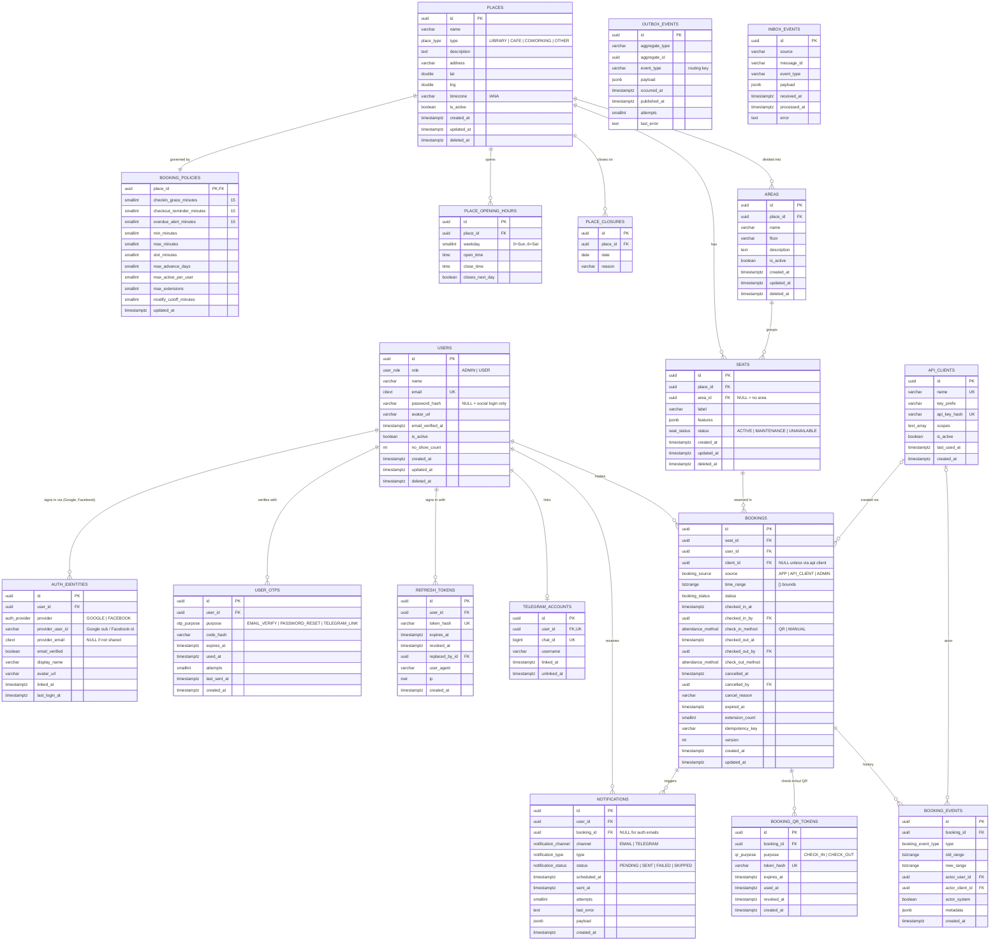
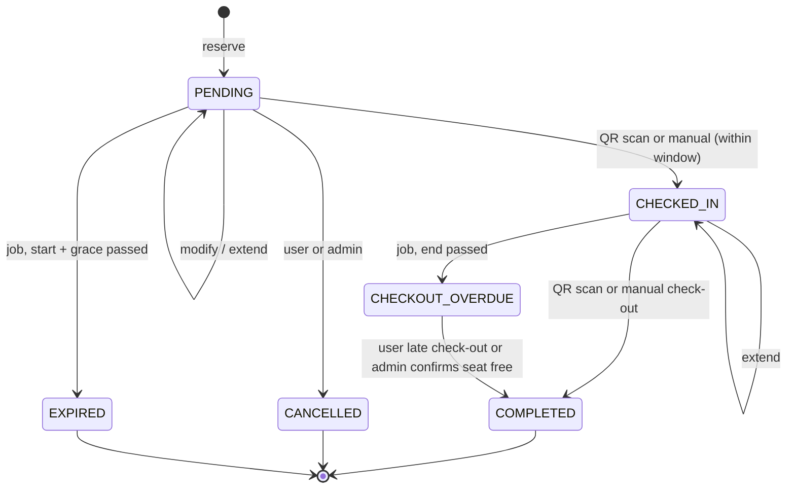

# Database ERD

Source of truth for the schema. Any schema change must update this file, `docs/schema/db.sql`, the TypeORM entity, and a migration in the same PR.

**Database:** PostgreSQL 17. Extensions: `btree_gist` (exclusion constraint), `citext` (case-insensitive email), `pgcrypto` (`gen_random_uuid()`).

**Tables (18):**

| Group | Tables |
|---|---|
| Auth & users | `users`, `auth_identities`, `user_otps`, `refresh_tokens` |
| Places & seats | `places`, `place_opening_hours`, `place_closures`, `booking_policies`, `areas`, `seats` |
| Bookings | `bookings`, `booking_events`, `booking_qr_tokens` |
| Notifications | `telegram_accounts`, `notifications` |
| Integration | `api_clients`, `outbox_events`, `inbox_events` |

The app is an **independent** space-booking backend. Other apps and services integrate with it **synchronously** over the REST API (authenticated as `api_clients`) and **asynchronously** over RabbitMQ (events published from `outbox_events`, consumed messages deduplicated in `inbox_events`). See `docs/decisions/0001-independent-backend-integration.md`.

## 1. Diagram



`OUTBOX_EVENTS.aggregate_id` and `INBOX_EVENTS` have no FKs on purpose: they are message logs, decoupled from the rows they describe.

## 2. Roles

Only two roles exist in this app. Roles that belong to other systems (library member, librarian, ...) are **not** modelled here; if an integrating app needs them later, they go in a phase-2 `external_identities` table (see section 10).

| Role | Meaning |
|---|---|
| `USER` | Default for self-registration. Browses places and seats, books, modifies, extends, cancels, checks in/out by QR, links Telegram. |
| `ADMIN` | Manages places, areas, seats, policies and bookings; monitors occupancy; manual check-in/out; resolves overdue checkouts; manages API clients. |

### Permission matrix

| Action | Public | USER | ADMIN | API client |
|---|---|---|---|---|
| Browse places, areas, seats, availability | yes | yes | yes | scope `places:read` |
| Reserve / modify / extend / cancel own booking | no | yes | no | scope `bookings:write` (on behalf of a user) |
| Get own booking QR, scan QR check-in/out | no | yes | scan only | no |
| Link / unlink Telegram | no | yes | no | no |
| Manage places, areas, seats, policies | no | no | yes | no |
| View all bookings, cancel any, manual check-in/out | no | no | yes | no |
| Dashboard, occupancy, overdue, no-shows | no | no | yes | no |
| Manage API clients | no | no | yes | no |

## 3. Table dictionary

Unless stated, `id` is `uuid PK DEFAULT gen_random_uuid()`, `created_at`/`updated_at` are `timestamptz NOT NULL DEFAULT now()`, and `deleted_at` is `timestamptz NULL` (soft delete; rows with history are never hard-deleted).

### users
| Column | Type | Constraints |
|---|---|---|
| role | user_role | NOT NULL, default `USER` |
| name | varchar(100) | NOT NULL |
| email | citext | NOT NULL, UNIQUE |
| password_hash | varchar(255) | NULL for users who only sign in with Google/Facebook; never returned or logged |
| avatar_url | varchar(500) | NULL (may be copied from the social profile) |
| email_verified_at | timestamptz | NULL until OTP verified, or set at sign-up when the provider reports a verified email |
| is_active | boolean | NOT NULL, default true |
| no_show_count | int | NOT NULL, default 0, `CHECK (>= 0)` |
| created_at, updated_at, deleted_at | | |

Rule (service layer, cross-table so not a DB CHECK): a user always keeps at least one sign-in method, `password_hash IS NOT NULL` or at least one `auth_identities` row. `users.email` stays NOT NULL: if a provider does not share an email (Facebook can omit it), sign-up asks for one and verifies it by OTP before the account is active.

### auth_identities
Third-party sign-in accounts (Google, Facebook) linked to a user. Used only to sign people in; not for integrating apps (see `api_clients` and phase-2 `external_identities`).
| Column | Type | Constraints |
|---|---|---|
| user_id | uuid | NOT NULL, FK -> users.id ON DELETE CASCADE |
| provider | auth_provider | NOT NULL |
| provider_user_id | varchar(255) | NOT NULL; the provider's stable id (Google `sub`, Facebook user id). Accounts are matched on this, **never on email** |
| provider_email | citext | NULL |
| email_verified | boolean | NOT NULL, default false; as reported by the provider (Facebook is treated as `false`) |
| display_name | varchar(100) | NULL |
| avatar_url | varchar(500) | NULL |
| linked_at | timestamptz | NOT NULL, default `now()` |
| last_login_at | timestamptz | NULL |

UNIQUE `(provider, provider_user_id)`: one social account maps to exactly one user. UNIQUE `(user_id, provider)`: at most one account per provider per user.

Provider access/refresh tokens are **not stored**; sign-in only needs the verified identity. Short-lived OAuth data lives in Redis, not in tables: callback `state` (with nonce, PKCE verifier, allowed `redirect_uri`, intent LOGIN/LINK, user id for LINK; 10 min), the one-time login code returned by the callback (60 s), and the `signupTicket` for providers that share no email (15 min). All are single use (deleted on read).

### user_otps
One-time codes sent by email (verify, reset) or used in the Telegram deep link.
| Column | Type | Constraints |
|---|---|---|
| user_id | uuid | NOT NULL, FK -> users.id ON DELETE CASCADE |
| purpose | otp_purpose | NOT NULL |
| code_hash | varchar(255) | NOT NULL (only the hash is stored) |
| expires_at | timestamptz | NOT NULL |
| used_at | timestamptz | NULL; set once, code is then dead |
| attempts | smallint | NOT NULL, default 0 (lock after N wrong tries) |
| last_sent_at | timestamptz | NOT NULL, default `now()` (resend rate limit) |
| created_at | | |

Partial UNIQUE `(user_id, purpose) WHERE used_at IS NULL`: at most one live code per purpose; issuing a new one replaces the old.

### refresh_tokens
| Column | Type | Constraints |
|---|---|---|
| user_id | uuid | NOT NULL, FK -> users.id ON DELETE CASCADE |
| token_hash | varchar(255) | NOT NULL, UNIQUE |
| expires_at | timestamptz | NOT NULL |
| revoked_at | timestamptz | NULL; set on logout, rotation, password change |
| replaced_by_id | uuid | NULL, FK -> refresh_tokens.id (rotation chain; reuse of a rotated token revokes the chain) |
| user_agent | varchar(255) | NULL |
| ip | inet | NULL |
| created_at | | |

### places
| Column | Type | Constraints |
|---|---|---|
| name | varchar(150) | NOT NULL |
| type | place_type | NOT NULL |
| description | text | NULL |
| address | varchar(255) | NOT NULL |
| lat, lng | double precision | NULL, `CHECK (lat BETWEEN -90 AND 90)`, `CHECK (lng BETWEEN -180 AND 180)` |
| timezone | varchar(64) | NOT NULL, default `'Asia/Phnom_Penh'` (Cambodia, UTC+7), IANA name (validated in app) |
| is_active | boolean | NOT NULL, default true |
| created_at, updated_at, deleted_at | | |

### place_opening_hours
No row for a weekday = closed that day.
| Column | Type | Constraints |
|---|---|---|
| place_id | uuid | NOT NULL, FK -> places.id ON DELETE CASCADE |
| weekday | smallint | NOT NULL, `CHECK (weekday BETWEEN 0 AND 6)` |
| open_time | time | NOT NULL |
| close_time | time | NOT NULL |
| closes_next_day | boolean | NOT NULL, default false (overnight venues) |

UNIQUE `(place_id, weekday)`. `CHECK (closes_next_day OR open_time < close_time)`.

### place_closures
| Column | Type | Constraints |
|---|---|---|
| place_id | uuid | NOT NULL, FK -> places.id ON DELETE CASCADE |
| date | date | NOT NULL (local date in `places.timezone`) |
| reason | varchar(255) | NULL |

UNIQUE `(place_id, date)`.

### booking_policies
One row per place, created with the place. Replaces hardcoded "15 minutes".
| Column | Type | Default | Constraints |
|---|---|---|---|
| place_id | uuid | | PK, FK -> places.id ON DELETE CASCADE |
| checkin_grace_minutes | smallint | 15 | `>= 0`; after start + grace, PENDING → EXPIRED |
| checkout_reminder_minutes | smallint | 15 | `>= 0`; reminder at end − N |
| overdue_alert_minutes | smallint | 15 | `>= 0`; forgotten-checkout alert at end + N |
| min_minutes | smallint | 30 | `>= 1` |
| max_minutes | smallint | 240 | `>= min_minutes` |
| slot_minutes | smallint | 15 | `>= 1`; start/end must align to this |
| max_advance_days | smallint | 7 | `>= 0` |
| max_active_per_user | smallint | 1 | `>= 1`; counts PENDING + CHECKED_IN |
| max_extensions | smallint | 2 | `>= 0` |
| modify_cutoff_minutes | smallint | 30 | `>= 0`; no modify/cancel later than start − N |
| updated_at | timestamptz | `now()` | |

### areas
| Column | Type | Constraints |
|---|---|---|
| place_id | uuid | NOT NULL, FK -> places.id ON DELETE RESTRICT |
| name | varchar(100) | NOT NULL |
| floor | varchar(30) | NULL |
| description | text | NULL |
| is_active | boolean | NOT NULL, default true |
| created_at, updated_at, deleted_at | | |

Partial UNIQUE `(place_id, name) WHERE deleted_at IS NULL`. UNIQUE `(id, place_id)` (target for the composite FK from seats).

### seats
| Column | Type | Constraints |
|---|---|---|
| place_id | uuid | NOT NULL, FK -> places.id ON DELETE RESTRICT |
| area_id | uuid | NULL; composite FK `(area_id, place_id)` -> areas `(id, place_id)` so a seat's area is always in the same place |
| label | varchar(30) | NOT NULL |
| features | jsonb | NOT NULL, default `'{}'` (power, window, desk size) |
| status | seat_status | NOT NULL, default `ACTIVE` |
| created_at, updated_at, deleted_at | | |

Partial UNIQUE `(place_id, label) WHERE deleted_at IS NULL`.

### bookings
| Column | Type | Constraints |
|---|---|---|
| seat_id | uuid | NOT NULL, FK -> seats.id ON DELETE RESTRICT |
| user_id | uuid | NOT NULL, FK -> users.id ON DELETE RESTRICT |
| client_id | uuid | NULL, FK -> api_clients.id; set when created by an integrating app |
| source | booking_source | NOT NULL, default `APP` |
| time_range | tstzrange | NOT NULL |
| status | booking_status | NOT NULL, default `PENDING` |
| checked_in_at | timestamptz | NULL |
| checked_in_by | uuid | NULL, FK -> users.id (the user, or the admin for manual) |
| check_in_method | attendance_method | NULL |
| checked_out_at | timestamptz | NULL |
| checked_out_by | uuid | NULL, FK -> users.id |
| check_out_method | attendance_method | NULL |
| cancelled_at | timestamptz | NULL |
| cancelled_by | uuid | NULL, FK -> users.id |
| cancel_reason | varchar(255) | NULL |
| expired_at | timestamptz | NULL |
| extension_count | smallint | NOT NULL, default 0 |
| idempotency_key | varchar(100) | NULL |
| version | int | NOT NULL, default 1 (TypeORM `@VersionColumn`, optimistic lock for modify/extend) |
| created_at, updated_at | | |

Partial UNIQUE `(user_id, idempotency_key) WHERE idempotency_key IS NOT NULL`: a retried `POST /bookings` returns the original booking instead of a 409.

### booking_events
Append-only history. Needed because modify/extend overwrite `time_range`.
| Column | Type | Constraints |
|---|---|---|
| booking_id | uuid | NOT NULL, FK -> bookings.id ON DELETE CASCADE |
| type | booking_event_type | NOT NULL |
| old_range | tstzrange | NULL (MODIFIED / EXTENDED) |
| new_range | tstzrange | NULL |
| actor_user_id | uuid | NULL, FK -> users.id |
| actor_client_id | uuid | NULL, FK -> api_clients.id |
| actor_system | boolean | NOT NULL, default false (scheduled jobs) |
| metadata | jsonb | NOT NULL, default `'{}'` |
| created_at | | |

`CHECK (actor_system OR actor_user_id IS NOT NULL OR actor_client_id IS NOT NULL)`.

### booking_qr_tokens
One-time QR codes. The QR image encodes a random token; only its hash is stored.
| Column | Type | Constraints |
|---|---|---|
| booking_id | uuid | NOT NULL, FK -> bookings.id ON DELETE CASCADE |
| purpose | qr_purpose | NOT NULL |
| token_hash | varchar(255) | NOT NULL, UNIQUE |
| expires_at | timestamptz | NOT NULL |
| used_at | timestamptz | NULL; set in the same transaction as the check-in/out |
| revoked_at | timestamptz | NULL; set when a newer QR is issued |
| created_at | | |

Partial UNIQUE `(booking_id, purpose) WHERE used_at IS NULL AND revoked_at IS NULL`: at most one live QR per action. Validity window (e.g. check-in QR only from start − X until start + grace) is enforced in code.

### telegram_accounts
| Column | Type | Constraints |
|---|---|---|
| user_id | uuid | NOT NULL, FK -> users.id ON DELETE CASCADE |
| chat_id | bigint | NOT NULL |
| username | varchar(64) | NULL |
| linked_at | timestamptz | NOT NULL, default `now()` |
| unlinked_at | timestamptz | NULL |

Partial UNIQUE `(user_id) WHERE unlinked_at IS NULL` and `(chat_id) WHERE unlinked_at IS NULL`: one live link per user and per chat; old links are kept for history.

Linking flow: `POST /telegram/link` creates a `TELEGRAM_LINK` row in `user_otps` and returns `https://t.me/<bot>?start=<code>`. The user presses Start; `POST /webhooks/telegram` receives `/start <code>`, matches the hash, stores `chat_id`.

### notifications
| Column | Type | Constraints |
|---|---|---|
| user_id | uuid | NOT NULL, FK -> users.id ON DELETE CASCADE |
| booking_id | uuid | NULL, FK -> bookings.id ON DELETE CASCADE; NULL for auth emails |
| channel | notification_channel | NOT NULL |
| type | notification_type | NOT NULL |
| status | notification_status | NOT NULL, default `PENDING` |
| scheduled_at | timestamptz | NOT NULL, default `now()` |
| sent_at | timestamptz | NULL |
| attempts | smallint | NOT NULL, default 0 |
| last_error | text | NULL |
| payload | jsonb | NOT NULL, default `'{}'`; **never contains OTP codes or tokens** |
| created_at | | |

Partial UNIQUE `(booking_id, type, channel) WHERE booking_id IS NOT NULL`: jobs can run repeatedly without double-sending. A Telegram notification for a user with no live `telegram_accounts` row is marked `SKIPPED`.

Channel rule: `EMAIL` only for `EMAIL_VERIFY_OTP` / `PASSWORD_RESET_OTP`; booking types go to `TELEGRAM`.

### api_clients
Other apps/services calling our REST API (sync integration). Not human users.
| Column | Type | Constraints |
|---|---|---|
| name | varchar(100) | NOT NULL, UNIQUE |
| key_prefix | varchar(12) | NOT NULL (shown in admin UI to identify the key) |
| api_key_hash | varchar(255) | NOT NULL, UNIQUE; the raw key is shown once at creation |
| scopes | text[] | NOT NULL, default `'{}'` (e.g. `places:read`, `bookings:read`, `bookings:write`) |
| is_active | boolean | NOT NULL, default true |
| last_used_at | timestamptz | NULL |
| created_at | | |

### outbox_events
Events we publish to RabbitMQ (async integration). Rows are inserted **in the same transaction** as the change they describe; a relay job publishes unpublished rows to the topic exchange `space-booking.events` with `event_type` as routing key, then sets `published_at`. Delivery is at-least-once; consumers must dedupe on `id`.
| Column | Type | Constraints |
|---|---|---|
| aggregate_type | varchar(50) | NOT NULL (`booking`, `seat`, `place`, `user`) |
| aggregate_id | uuid | NOT NULL |
| event_type | varchar(100) | NOT NULL |
| payload | jsonb | NOT NULL (no secrets, no password/token fields) |
| occurred_at | timestamptz | NOT NULL, default `now()` |
| published_at | timestamptz | NULL |
| attempts | smallint | NOT NULL, default 0 |
| last_error | text | NULL |

### inbox_events
Messages we consume (RabbitMQ from other services, Telegram webhook updates). Used for idempotency.
| Column | Type | Constraints |
|---|---|---|
| source | varchar(100) | NOT NULL (`telegram`, or the producing service name) |
| message_id | varchar(100) | NOT NULL (RabbitMQ `message_id`, Telegram `update_id`) |
| event_type | varchar(100) | NOT NULL |
| payload | jsonb | NOT NULL |
| received_at | timestamptz | NOT NULL, default `now()` |
| processed_at | timestamptz | NULL |
| error | text | NULL |

UNIQUE `(source, message_id)`: insert first; on conflict the message was already handled, ack and skip.

## 4. Enums

| Enum | Values |
|---|---|
| user_role | `ADMIN`, `USER` |
| auth_provider | `GOOGLE`, `FACEBOOK` |
| otp_purpose | `EMAIL_VERIFY`, `PASSWORD_RESET`, `TELEGRAM_LINK` |
| place_type | `LIBRARY`, `CAFE`, `COWORKING`, `OTHER` |
| seat_status | `ACTIVE`, `MAINTENANCE`, `UNAVAILABLE` |
| booking_source | `APP`, `API_CLIENT`, `ADMIN` |
| booking_status | `PENDING`, `CHECKED_IN`, `CHECKOUT_OVERDUE`, `COMPLETED`, `CANCELLED`, `EXPIRED` |
| attendance_method | `QR`, `MANUAL` |
| booking_event_type | `CREATED`, `MODIFIED`, `EXTENDED`, `CHECKED_IN`, `CHECKED_OUT`, `CANCELLED`, `EXPIRED`, `OVERDUE`, `OVERDUE_RESOLVED` |
| qr_purpose | `CHECK_IN`, `CHECK_OUT` |
| notification_channel | `EMAIL`, `TELEGRAM` |
| notification_type | `EMAIL_VERIFY_OTP`, `PASSWORD_RESET_OTP`, `BOOKING_CONFIRMED`, `BOOKING_CANCELLED`, `LATE_CHECKIN`, `CHECKOUT_REMINDER`, `BOOKING_EXPIRED`, `FORGOTTEN_CHECKOUT` |
| notification_status | `PENDING`, `SENT`, `FAILED`, `SKIPPED` |

### Booking status flow



## 5. Constraints that live in migrations (raw SQL)

TypeORM decorators cannot express these. Add them with `queryRunner.query(...)`.

```sql
CREATE EXTENSION IF NOT EXISTS btree_gist;
CREATE EXTENSION IF NOT EXISTS citext;
CREATE EXTENSION IF NOT EXISTS pgcrypto;

-- Core guarantee: no double-booking. Also guards UPDATEs (modify / extend).
ALTER TABLE bookings ADD CONSTRAINT no_double_booking
  EXCLUDE USING gist (seat_id WITH =, time_range WITH &&)
  WHERE (status IN ('PENDING', 'CHECKED_IN', 'CHECKOUT_OVERDUE'));

-- Ranges are half-open [start, end) and non-empty
ALTER TABLE bookings ADD CONSTRAINT bookings_range_valid
  CHECK (NOT isempty(time_range)
         AND lower_inc(time_range) AND NOT upper_inc(time_range)
         AND NOT lower_inf(time_range) AND NOT upper_inf(time_range));

-- Timestamps must match status
ALTER TABLE bookings ADD CONSTRAINT bookings_cancel_consistent
  CHECK ((status = 'CANCELLED') = (cancelled_at IS NOT NULL));
ALTER TABLE bookings ADD CONSTRAINT bookings_expire_consistent
  CHECK ((status = 'EXPIRED') = (expired_at IS NOT NULL));
ALTER TABLE bookings ADD CONSTRAINT bookings_checkin_consistent
  CHECK ((status IN ('CHECKED_IN', 'CHECKOUT_OVERDUE', 'COMPLETED')) = (checked_in_at IS NOT NULL));
ALTER TABLE bookings ADD CONSTRAINT bookings_checkout_consistent
  CHECK ((status = 'COMPLETED') = (checked_out_at IS NOT NULL)
         AND (checked_out_at IS NULL OR checked_out_at >= checked_in_at));
ALTER TABLE bookings ADD CONSTRAINT bookings_client_consistent
  CHECK ((source = 'API_CLIENT') = (client_id IS NOT NULL));

-- Seat's area must belong to the same place
ALTER TABLE areas ADD CONSTRAINT areas_id_place_uk UNIQUE (id, place_id);
ALTER TABLE seats ADD CONSTRAINT seats_area_same_place
  FOREIGN KEY (area_id, place_id) REFERENCES areas (id, place_id);
```

Additional CHECKs (full DDL in `docs/schema/db.sql`):

- `bookings`: `check_in_method` set exactly when `checked_in_at` is set, `check_out_method` exactly when `checked_out_at` is set, `extension_count >= 0`.
- `notifications`: `(channel = 'EMAIL') = (type IN ('EMAIL_VERIFY_OTP', 'PASSWORD_RESET_OTP'))`, `(status = 'SENT') = (sent_at IS NOT NULL)`, `attempts >= 0`.
- `user_otps.attempts >= 0`, `outbox_events.attempts >= 0`.
- A `set_updated_at()` trigger on every table with `updated_at`, so raw SQL updates keep it correct too.

The exclusion violation surfaces as Postgres error `23P01`; the bookings service maps it to `409 Conflict` for create, modify and extend.

## 6. Indexes

| Index | Purpose |
|---|---|
| `bookings` GiST `(seat_id, time_range)` | Created by `no_double_booking`; also serves availability overlap queries |
| `bookings (user_id, created_at DESC)` | My bookings / upcoming / history |
| `bookings (status, lower(time_range))`, `bookings (status, upper(time_range))` | Expire job (by start), overdue / reminder jobs (by end); admin active/overdue lists |
| `bookings (client_id)` | Bookings per integrating app |
| `booking_events (booking_id, created_at)` | Booking timeline |
| `booking_qr_tokens (booking_id)` | Revoke previous QR |
| `seats (place_id, area_id)` | Seats per place / area |
| `seats` GIN `(features)` | Filter by features |
| `areas (place_id)` | Areas per place |
| `auth_identities (user_id)` | List / unlink a user's identities |
| `user_otps (user_id, purpose)` | OTP lookup |
| `refresh_tokens (user_id)` | Revoke all on logout-all / password change |
| `notifications (scheduled_at) WHERE status = 'PENDING'` | Notification worker |
| `notifications (user_id, created_at DESC)` | User's notifications |
| `outbox_events (occurred_at) WHERE published_at IS NULL` | Outbox relay |

## 7. Derived values (never stored)

- **Seat availability for a range:** seat `status = 'ACTIVE'`, `deleted_at IS NULL`, place open for the whole range (opening hours + closures, in `places.timezone`), and no booking with status `PENDING`/`CHECKED_IN`/`CHECKOUT_OVERDUE` overlapping the range.
- **Occupied now:** a booking `CHECKED_IN` containing `now()`, **or any `CHECKOUT_OVERDUE` booking** on the seat (the user may still be sitting there, see rule 3 below).
- **Nearly timed out:** `CHECKED_IN` bookings where `upper(time_range) - now() <= checkout_reminder_minutes`.
- **Dashboard / occupancy / no-show stats:** aggregate queries over `bookings` and `seats`.

## 8. Business rules tied to the schema

1. **Create** runs in one transaction: insert `bookings`, `booking_events (CREATED)`, `notifications` (`BOOKING_CONFIRMED`, `LATE_CHECKIN` at start (skipped if already checked in; expiry follows at start + grace), `CHECKOUT_REMINDER` at end − N), and `outbox_events (booking.created)`. Limits come from `booking_policies` (duration, slot alignment, advance days, active count).
2. **Modify / extend** update `time_range` in a transaction with a `booking_events` row (old/new range), rescheduled notifications and an outbox event. The exclusion constraint rejects overlaps; `version` rejects concurrent edits. Extend increments `extension_count` (max from policy). Modify is only allowed while `PENDING` and before `start − modify_cutoff_minutes`.
3. **Expire job:** `PENDING` with `lower(time_range) + checkin_grace_minutes < now()` → `EXPIRED`, set `expired_at`, increment `users.no_show_count`, revoke live QR tokens, `BOOKING_EXPIRED` notification, outbox `booking.expired`. Seat is freed by the constraint's `WHERE`.
4. **Overdue job:** `CHECKED_IN` with `upper(time_range) < now()` → `CHECKOUT_OVERDUE`, `FORGOTTEN_CHECKOUT` notification at end + `overdue_alert_minutes`. Because the range has ended, a following booking may start at that time; availability and occupancy treat the seat as occupied *now* until an admin resolves it (`OVERDUE_RESOLVED` → `COMPLETED`).
5. **QR check-in/out:** token valid only if `used_at IS NULL AND revoked_at IS NULL AND expires_at > now()`; mark `used_at` in the same transaction as the status change. Check-in is accepted only within the window set in code (up to start + grace).
6. **Cancel** sets `status = CANCELLED`, `cancelled_at`, `cancelled_by`; rows are never deleted. Pending notifications for the booking become `SKIPPED`.
7. **Times** are `timestamptz` in UTC; opening hours and closures are evaluated in `places.timezone`; bookings in the past are rejected.
8. **OTPs and tokens:** only hashes are stored; single use; expiry enforced; `forgot-password` and `resend-otp` respond identically whether or not the email exists. Password change/reset revokes all refresh tokens.
9. **Social sign-in (Google, Facebook):**
   - Two entry points, same rules: the **redirect flow** (`GET /auth/oauth/:provider` → provider → `GET /auth/oauth/:provider/callback`, Authorization Code + PKCE, then the one-time login code is exchanged for tokens) and the **token flow** for mobile (`POST /auth/oauth/:provider/token`). In both, the backend verifies the identity with the provider (Google ID token: signature, `aud` = our client id, `iss`, `exp`; Facebook access token: Graph API `debug_token` with our app id, then `/me`). Then it issues our own access + refresh tokens like a password login.
   - Lookup order: (1) `auth_identities` by `(provider, provider_user_id)` → sign in. (2) Else, if the provider email is **verified** and matches an existing user → link and sign in. (3) Else, if the email matches an existing user but is **not verified** → reject with `409` and ask the user to sign in with their password (or email OTP) and link from their account. (4) Else → create a `USER` with `password_hash = NULL`, plus the identity, in one transaction.
   - Social sign-up never creates an `ADMIN`.
   - Unlinking the last sign-in method is rejected (`409`). Setting a password is allowed through forgot/reset password.
   - Banned or inactive users (`is_active = false`, `deleted_at` set) are rejected the same way as for password login.
10. **Soft delete:** places, areas and seats with bookings are soft-deleted (`deleted_at`), never hard-deleted, so history stays valid.

## 9. Spec coverage checklist

| Spec feature | Tables |
|---|---|
| Register, verify email, resend OTP, forgot/reset password | `users`, `user_otps`, `notifications` (EMAIL) |
| Login, refresh, logout | `refresh_tokens` |
| Sign in with Google / Facebook, link / unlink | `auth_identities`, `users`, `refresh_tokens` |
| Places (libraries), areas, seats, seat status | `places`, `place_opening_hours`, `place_closures`, `areas`, `seats` |
| Available seats for a time window | `seats`, `bookings`, `place_opening_hours`, `place_closures` |
| Reserve, modify, extend, cancel, history | `bookings`, `booking_events`, `booking_policies` |
| QR check-in / check-out, attendance status | `booking_qr_tokens`, `bookings` |
| Auto-expire after 15 min, overdue checkout | `bookings`, `booking_policies` (jobs) |
| Telegram link / status / unlink / webhook | `telegram_accounts`, `user_otps`, `inbox_events` |
| Telegram alerts (confirm, late check-in, reminder, expiry, forgotten checkout) | `notifications` |
| Admin dashboard, occupancy, overdue, no-shows | derived from `bookings`, `seats` |
| Other apps call our API (sync) | `api_clients`, `bookings.client_id` |
| Other services consume / produce events (async, RabbitMQ) | `outbox_events`, `inbox_events` |

## 10. Phase 2 (not in the first migration)

- **external_identities** `(user_id, client_id, external_user_id, external_role, metadata, verified_at)`, UNIQUE `(client_id, external_user_id)`: map users of an integrating app (e.g. a library system member) to our users, and carry their external role. Add only when an integrating app books on behalf of its own users.
- **Per-role policy overrides** (e.g. members of an external system get longer bookings), built on `external_identities`.
