# Space Booking: system lifecycle and workflows

How the whole platform works, from boot to booking to partner sync.
Each section is one panel for a later PNG infographic. Diagrams are Mermaid.

**Legend:** ✅ implemented · 🟡 partly implemented / interim · ⏳ planned (not in code)

Sources: `src/**`, `docs/erd.md`, `docs/integration/*`, [`docs/external-doc.md`](./external-doc.md).
All routes are prefixed with `/api/v1`. All times are UTC `timestamptz`.

---

## 1. System at a glance

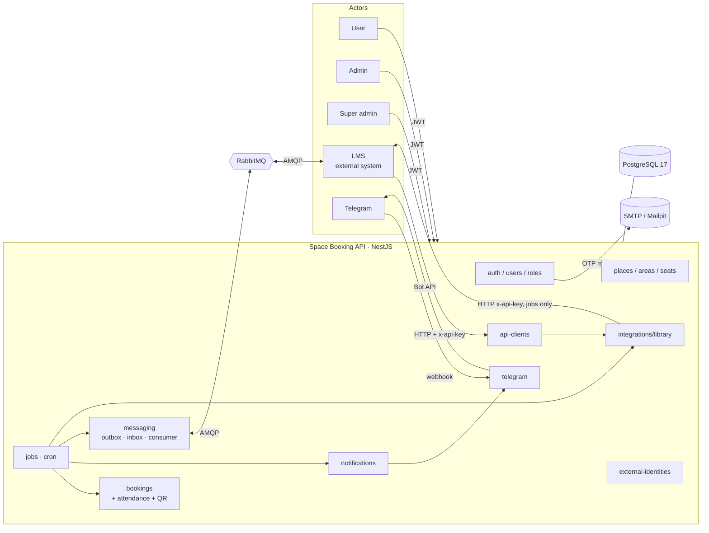

| Layer | Modules | Status |
|---|---|---|
| Identity | `auth`, `users` (entities), `roles`, `api-clients`, `external-identities` | ✅ (`UsersController` is an unimplemented scaffold 🟡) |
| Catalog | `places` (+ policy, hours, closures), `areas`, `seats` | ✅ |
| Booking | `bookings` (create/modify/extend/cancel, QR, attendance, lifecycle) | ✅ |
| Delivery | `notifications` (Telegram channel only), `telegram` | ✅ |
| Integration | `messaging`, `integrations/http`, `integrations/library` | ✅ (LMS only) |
| Ops | `jobs`, `logger`, `configuration`, `database` | ✅ |
| Not present | Seat availability endpoints (`/seats/available`, `/seats/:id/availability`), `health/` module, Redis usage, `auth_identities` usage, booking on behalf of partner members | ⏳ |

---

## 2. Application lifecycle

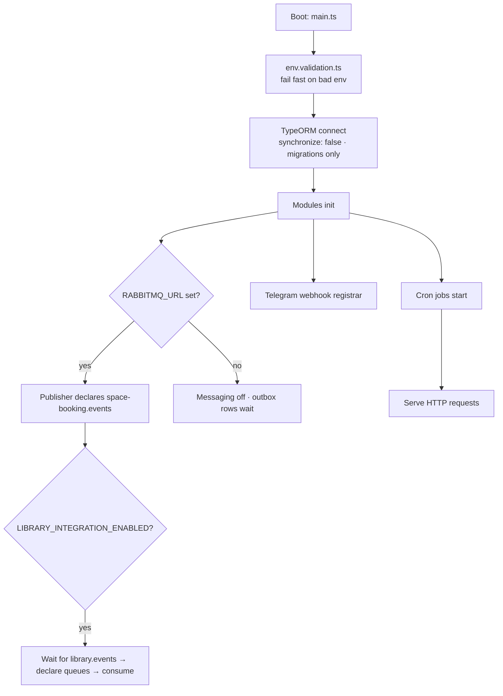

**Background jobs** (`src/jobs/`, `src/integrations/library/jobs/`):

| Job | Every | Does |
|---|---|---|
| `outbox-relay` | 5 s | Publishes `outbox_events` to RabbitMQ (no-op without a broker) |
| `notification-dispatch` | 30 s | Sends due `notifications` via Telegram, retries with backoff (1, 2, 4 … 60 min) |
| `expire-bookings` | 1 min | `PENDING` past start + grace → `EXPIRED`, counts a no-show |
| `overdue-checkouts` | 1 min | `CHECKED_IN` past end + `overdue_alert_minutes` → `CHECKOUT_OVERDUE` |
| `auth-cleanup` | 1 h | Deletes OTPs and refresh tokens one day after they expire |
| `lms-place-repair` | 1 h | Re-pulls 50 LMS place snapshots over HTTP (no-op without `LMS_BASE_URL`) |

**Core guarantees** (AGENTS.md §6):
- No double-booking: the DB exclusion constraint `no_double_booking` rejects overlaps (`23P01` → `409`). There is no "check then insert".
- Every booking change commits in **one transaction** with its `booking_events`, `notifications` and `outbox_events` rows.
- Policy values come from `booking_policies`, one row per place. Defaults:

  | Policy | Default |
  |---|---|
  | `checkin_grace` | 15 min |
  | `late_checkin_alert` | 5 min |
  | `checkout_reminder` | 15 min |
  | `overdue_alert` | 15 min |
  | Booking length (min–max) | 30–240 min |
  | `slot` | 15 min |
  | `max_advance_days` | 7 |
  | `max_active_per_user` | 1 |
  | `max_extensions` | 2 |
  | `modify_cutoff` | 30 min |

---

## 3. User journey

```mermaid
flowchart LR
  R[Register] --> V[Verify email OTP] --> L[Login] --> BR[Browse places · areas · seats]
  BR --> BK[Book seat(s)] --> Q[Get check-in QR] --> CI[Check in] --> CO[Check out]
  BK -.-> M[Modify / Extend / Cancel]
  L -.-> TGL[Link Telegram]
  L -.-> LMSL[Link LMS member]
  BK & CI & CO -.-> N[Telegram alerts]
```

### 3.1 Registration and authentication ✅

| Step | Route | Notes |
|---|---|---|
| Register | `POST /auth/register` | Role `USER` or `ADMIN`. An ADMIN request is stored as a USER with `admin_request_status = PENDING`. `SUPER_ADMIN` is refused. The response is the same whether or not the email exists |
| Verify | `POST /auth/verify-email`, `POST /auth/resend-otp` | OTP sent by email (`MailService`), hash only, limited attempts |
| Login | `POST /auth/login` | Needs a verified email, an active account and no pending admin request. Returns access and refresh tokens |
| Refresh | `POST /auth/refresh-token` | Rotation; re-using an old token revokes **all** of that user's sessions |
| Session | `GET /auth/me`, `PATCH /auth/change-password`, `POST /auth/logout`, `POST /auth/logout-all` | |
| Password reset | `POST /auth/forgot-password` → `POST /auth/reset-password` | Email OTP |
| Google 🟡 | `GET /auth/google` → `/auth/google/callback` | Finds the user by `googleId`, links an existing email if Google verified it, or creates a USER. Issues an **access token only**, without the login checks above |

Auth routes are rate-limited (`src/auth/auth-throttle.ts`).

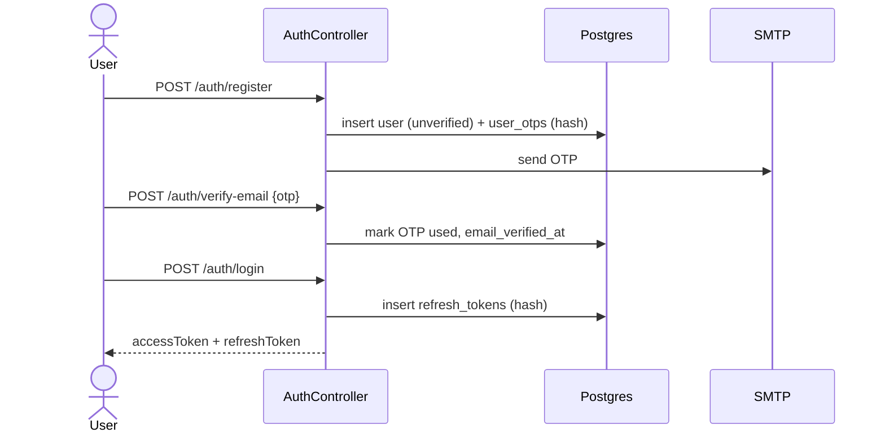

### 3.2 Browsing ✅ (public, no login)

- `GET /places`, `GET /places/:placeId`: active places only.
- `GET /places/:placeId/areas`.
- `GET /seats`, `GET /seats/:seatId`, `GET /places/:placeId/seats`.
- Availability is **derived from bookings**; there is no `is_available` column. Dedicated availability endpoints are ⏳.

### 3.3 Booking ✅ (`USER` role)

| Action | Route | Rule |
|---|---|---|
| Book | `POST /bookings` | One or more seats of one place, same time, all-or-nothing (`group_id`). Optional `Idempotency-Key`. Checks: policy, opening hours and closures, `max_active_per_user`, LMS eligibility (§6.3) |
| List | `GET /bookings`, `/bookings/upcoming`, `/bookings/history`, `/bookings/:bookingId` | Own bookings only |
| Modify | `PATCH /bookings/:bookingId` | `PENDING` only, before start − `modify_cutoff` |
| Extend | `POST /bookings/:bookingId/extend` | `PENDING` or `CHECKED_IN`, up to `max_extensions` and `max_minutes` |
| Cancel | `POST /bookings/:bookingId/cancel` | `PENDING` only, before the cutoff. The row is kept and the seat freed |
| QR | `GET /bookings/:bookingId/qr-code` | One-time check-in or check-out QR (per seat or per group); reissuing revokes the previous one |
| Status | `GET /bookings/:bookingId/check-in-status` | Attendance state and check-in window |

### 3.4 Check-in / check-out ✅

- `POST /check-in/scan` and `POST /check-out/scan` (`USER` or `ADMIN`) take the QR text.
- Check-in is accepted from shortly before the start until start + `checkin_grace`.
- Only staff may scan another user's QR.
- Check-out by QR also closes a forgotten (`CHECKOUT_OVERDUE`) checkout.
- The QR token is marked used in the same transaction as the status change.

### 3.5 Notifications ✅ (Telegram) · email for auth only

1. **Link Telegram:** `POST /telegram/link` returns a `t.me` deep link with a one-time code. The user opens it, Telegram calls `POST /webhooks/telegram` (secret-guarded), and the account is linked. `GET /telegram/status`, `DELETE /telegram/unlink`.
2. **Alerts** are written as `notifications` rows inside the booking transaction, and the dispatcher sends them later. Several seats of one booking go out as one message.

| Alert | When |
|---|---|
| `BOOKING_CONFIRMED` | Right after booking |
| `LATE_CHECKIN` | start + `late_checkin_alert` |
| `CHECKOUT_REMINDER` | end − `checkout_reminder` |
| `BOOKING_MODIFIED`, `BOOKING_EXTENDED`, `CHECKED_IN`, `CHECKED_OUT`, `BOOKING_CANCELLED` | On the change |
| `BOOKING_EXPIRED` | On expiry |
| `FORGOTTEN_CHECKOUT` | On becoming overdue |

Alerts that no longer apply become `SKIPPED`. A modify or extend reschedules the pending ones.

---

## 4. Admin journey

| Area | Routes | Notes |
|---|---|---|
| Places ✅ | `POST /admin/places`, `PATCH /admin/places/:placeId`, `DELETE …` | Creates the place with its booking policy, opening hours and closures. Soft delete. For LMS-managed places, LMS-owned fields return `409`; admins keep `isActive` and the policy |
| Areas ✅ | `POST /admin/places/:placeId/areas`, `PATCH/DELETE /admin/areas/:areaId` | LMS-owned areas: `409` |
| Seats ✅ | `POST /admin/places/:placeId/seats`, `PATCH /admin/seats/:seatId`, `PATCH …/status` (`ACTIVE`/`MAINTENANCE`/`UNAVAILABLE`), `DELETE` | Deleting a seat with live bookings returns `409`. Soft delete |
| Bookings ✅ | `GET /admin/bookings`, `GET /admin/bookings/:bookingId` (with event history) | |
| | `PATCH /admin/bookings/:bookingId/status` | Cancel any `PENDING` booking without the cutoff, or resolve an overdue checkout |
| | `POST …/check-in`, `POST …/check-out` | Manual, without a QR |
| Users ✅ | `POST /admin/users/:userId/suspend`, `…/reactivate` | Suspending revokes sessions; role hierarchy enforced |
| Admin requests ✅ | `GET /auth/admin-requests`, `POST …/:userId/approve`, `…/reject` | `SUPER_ADMIN` only |
| Roles ✅ | `/admin/roles` CRUD | |
| API clients ✅ | `/admin/api-clients` (create, list, get, update, `rotate-key`) | Partner keys, shown once |
| LMS ✅ | `POST /admin/integrations/library/places/:placeId/resync` | Pull a place from LMS now |
| Users CRUD 🟡 | `/users` | Unimplemented Nest scaffold (ADMIN-only) |

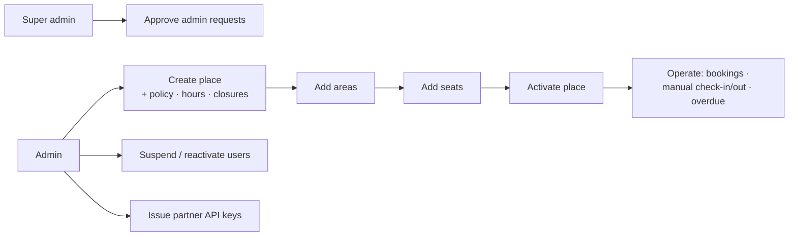

---

## 5. Booking lifecycle ✅

`src/bookings/domain/booking-state.ts`:

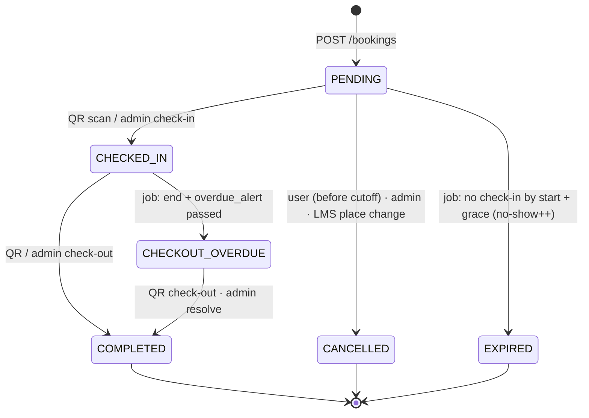

| Group | Statuses | Meaning |
|---|---|---|
| Holds the seat | `PENDING`, `CHECKED_IN`, `CHECKOUT_OVERDUE` | Covered by `no_double_booking` |
| Counts as active | `PENDING`, `CHECKED_IN` | Counted against `max_active_per_user` |
| Final | `COMPLETED`, `CANCELLED`, `EXPIRED` | No further changes |

Seat status is never changed by bookings.

**One booking change = one transaction:**

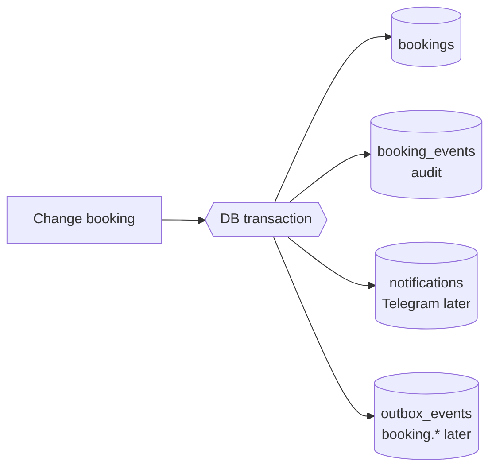

| Status change | `booking_events` | Routing key |
|---|---|---|
| create | `CREATED` | `booking.created` |
| modify | `MODIFIED` | `booking.modified` |
| extend | `EXTENDED` | `booking.extended` |
| cancel | `CANCELLED` | `booking.cancelled` |
| check-in | `CHECKED_IN` | `booking.checked_in` |
| check-out | `CHECKED_OUT` | `booking.checked_out` |
| expire | `EXPIRED` | `booking.expired` |
| overdue | `OVERDUE` | `booking.checkout_overdue` |

Reminders that are not status changes (late check-in, checkout reminder, forgotten checkout) are published as `booking.alert_due` when they become due.

---

## 6. External integration lifecycle (LMS) ✅

Details: [`docs/external-doc.md`](./external-doc.md).

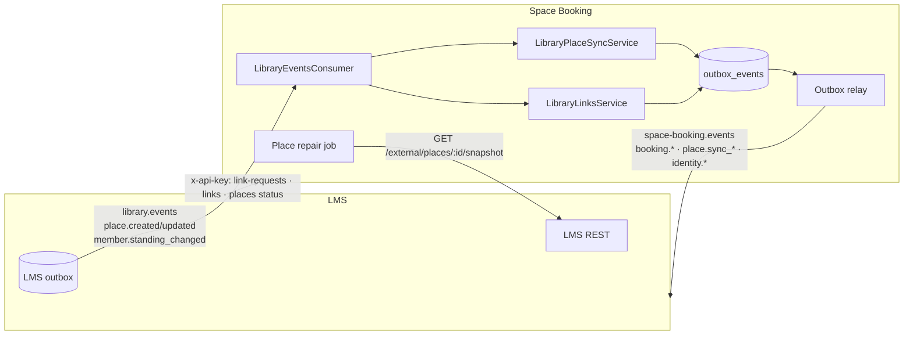

### 6.1 Account linking ✅

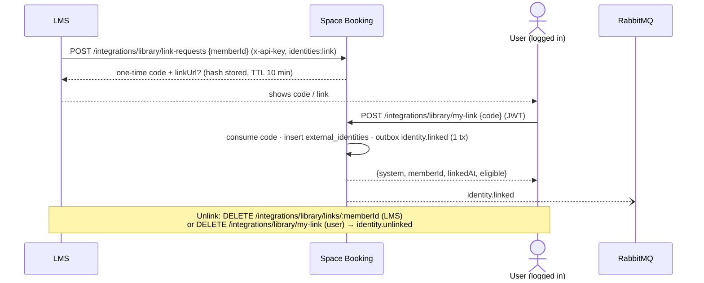

- One LMS member links to one user, never matched by email (D11).
- `409` if either side is already linked.

### 6.2 Place synchronization ✅

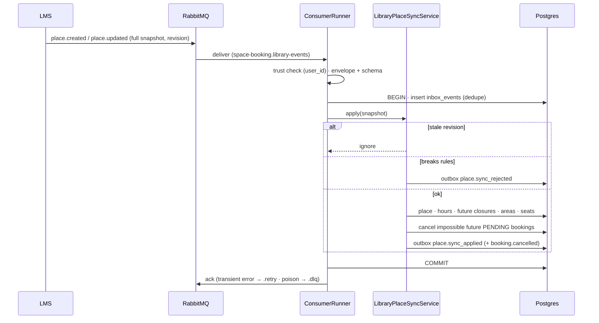

- New LMS places start **inactive** until our admin activates them.
- A safety net, the hourly repair job and the admin resync, pulls the same snapshot over HTTP.
- LMS can read sync status with `GET /integrations/library/places/:placeId` (`places:read`).

### 6.3 Eligibility check ✅

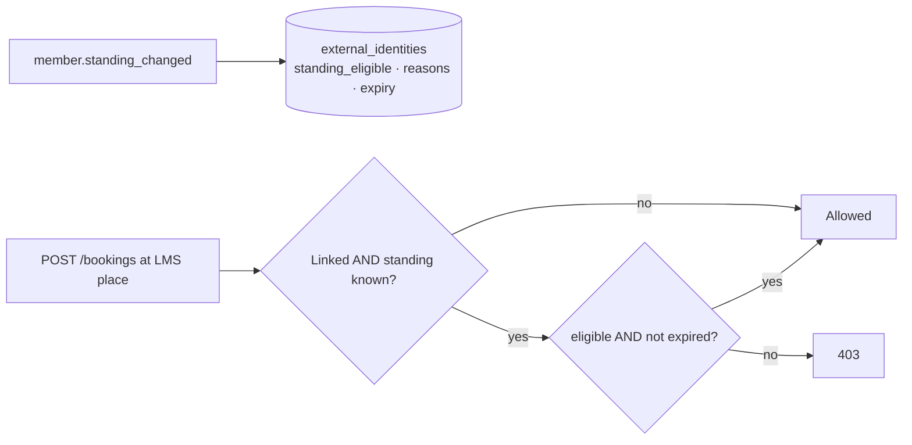

- Only **new** bookings are checked; existing ones are kept (D10).
- Standing that is older than what we have, or that belongs to an unlinked member, is ignored.

### 6.4 Booking events to LMS ✅

- Every `booking.*` envelope is published to `space-booking.events`.
- For LMS places it carries `external: { system, placeId, seatId, memberId }`; for other places `external` is null.
- Delivery is at least once and in `occurred_at` order; consumers dedupe on `message_id`.

### 6.5 RabbitMQ communication rules ✅

- Each system publishes only to its own exchange: `space-booking.events` and `library.events`.
- A consumer owns its queue.
- Sender proof is the broker-validated `user_id`, which must equal `app_id` and `source`.
- Every message is a versioned envelope validated against a JSON Schema on both send and receive (`src/messaging/contract/`).
- Failures: retry queue with TTL, then `.dlq` after `RABBITMQ_MAX_ATTEMPTS` or for poison messages.

---

## 7. Integrating a future partner

What is already generic, and what a new partner (for example a coworking operator) would need:

| Building block | Generic today? | To add a partner |
|---|---|---|
| API keys + scopes (`api-clients`) | ✅ any system | Issue a key; add scopes to `API_CLIENT_SCOPES` if needed |
| Outbox / inbox / `ConsumerRunner` | ✅ partner-agnostic | Add a `ConsumerRoute` (queue + partner exchange + handlers) |
| `ServiceHttpClient` | ✅ | Wrap it in a partner client (like `LmsClient`) |
| `places.external_system`, `external_identities.external_system` | ✅ free-text columns | Use a new system name |
| Admin edit lock for externally managed places | ✅ any `external_system` | none |
| Booking eligibility check | ✅ uses the place's `external_system` | Feed standing into `external_identities` |
| Message contract (`schemas.ts`, `types.ts`) | ❌ allows only `source: space-booking \| library` and `system: library` | Widen the enums; add the partner's message schemas |
| `external` block in `booking.*` events | ❌ hard-coded to `'library'` (`booking-activity.service.ts`, `booking-alert-events.ts`) | Make it per-system |
| Integration module | ❌ LMS-specific | New `src/integrations/<partner>/` following `library/` |
| Booking on behalf of a partner member (`@UserOrClient`, `X-External-User`, scopes `bookings:read/write`) | ⏳ scopes defined, no routes | Planned phase 3 |

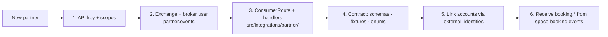

---

## 8. Module interactions

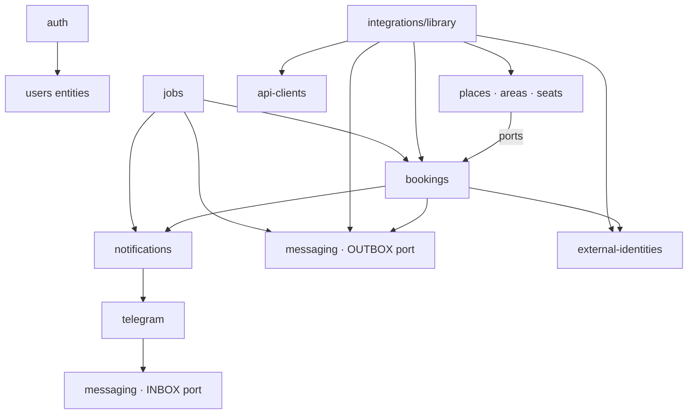

- **Ports** (injection token + interface) decouple modules: `bookings.ports.ts` (seats, place rules, outbox, no-show counter) and `telegram.ports.ts` (link codes, inbox).
- ✅ The no-show counter is `UsersService.incrementNoShow` and Telegram link codes are `OtpService` (users module).

| Actor | Talks to | Through |
|---|---|---|
| User | auth, catalog, bookings, attendance, telegram, my-link | REST + JWT |
| Admin / Super admin | admin-* controllers | REST + JWT + role |
| LMS | link-requests, links, place status | REST + `x-api-key` + scope |
| LMS | consumer / publisher | RabbitMQ (`library.events` ⇄ `space-booking.events`) |
| Telegram | webhook | `X-Telegram-Bot-Api-Secret-Token` guard |
| Scheduler | jobs | `@nestjs/schedule` cron |

---

## 9. Infographic outline (for the PNG)

1. **Top band:** actors (User, Admin, Super admin, LMS, Telegram) around the API, with Postgres and RabbitMQ below (§1).
2. **Left column:** user journey, Register → Verify → Login → Browse → Book → QR → Check-in → Check-out, with Telegram alerts as side bubbles (§3).
3. **Center:** booking state machine (§5) with the "one transaction" fan-out.
4. **Right column:** admin setup, Place → Areas → Seats → Activate → Operate (§4).
5. **Bottom band:** LMS lifecycle, Link → Sync → Eligibility → Events, with the exchanges and queues (§6).
6. **Footer:** cron jobs (§2) and the future-partner checklist (§7), with the legend ✅ 🟡 ⏳.
