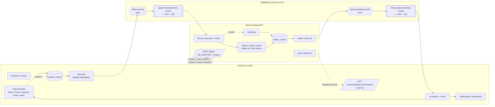
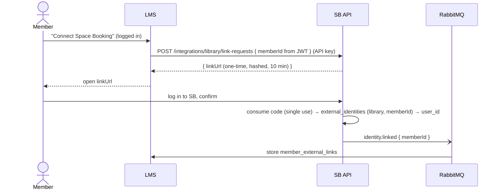

# LMS integration proposal: architecture, workflows and RabbitMQ contract

- **Status:** Proposal for review by both teams; not formally agreed. Space Booking has **implemented** S1–S13 (phase 1, plus the API-key guard from phase 2): see [`integration/lms-message-contract.md`](./integration/lms-message-contract.md) and [`integration/lms-booking-events-now.md`](./integration/lms-booking-events-now.md). Deviation: a first snapshot with `bookingEnabled = false` still creates the place (inactive), so LMS always gets a `place.sync_*` reply.
- **Companion document:** `library-management-system/docs/space-booking-proposal.md` (the Place Module and the changes on the LMS side).
- **How-to companions:** [`integration/README.md`](./integration/README.md) (short answers), [`integration/service-authentication.md`](./integration/service-authentication.md) (how the two systems trust each other over HTTP and RabbitMQ), [`integration/implementation-plan.md`](./integration/implementation-plan.md) (setup, module layout, milestones).
- **Builds on:** [`docs/integration/messaging-contract.md`](./integration/messaging-contract.md) (envelope, naming, delivery; still *Proposed*), ADR [0001](./decisions/0001-independent-backend-integration.md), AGENTS.md §6.
- **Supersedes, once agreed:** the branch and member sections of [`docs/integration/lms-feature-proposal.md`](./integration/lms-feature-proposal.md) (F3, F4) and parts of [`docs/integration/library-management-system.md`](./integration/library-management-system.md). Those were written from the LMS project description. This document is based on the LMS **code** (`main` at `10339b0`). Section 1.2 lists what changed.

Labels used below: **[Existing]** is in the code today, **[Proposed]** is new, **[Decision]** needs agreement.

---

## 0. Summary

- **LMS owns the library as a physical place.** A new LMS Place Module holds location, time zone, opening hours, closures, areas and the seat inventory. Space Booking keeps a **read-only replica** of LMS-managed places, so booking keeps working when LMS is down.
- **Space Booking owns bookability.** It owns booking policies, bookings, availability, attendance, no-shows, and the go-live switch for a place.
- **Place sync is snapshot-based.** LMS publishes `place.created` / `place.updated`, each carrying the full place and a `revision`. We apply a snapshot only if its revision is newer, and confirm with `place.sync_applied` or `place.sync_rejected`. Lost, duplicated or reordered messages self-heal on the next revision.
- **We add LMS ids to booking events.** Our `booking.*` events gain an additive `external` block with LMS ids (`placeId`, `seatId`, `memberId`), so LMS never needs our ids.
- **Identity linking is explicit.** A one-time link flow replaces email matching. It's phase 2, and the reason is in section 1.2.
- **Three phases:** 1 place sync, 2 linking and member notifications, 3 member standing.

---

## 1. Analysis

### 1.1 Both systems today [Existing]

| Concern | Space Booking API | LibraFlow (LMS) |
|---|---|---|
| Stack | NestJS 12, TypeORM 1.x, Postgres 17, Jest | NestJS 12, TypeORM 1.x, Postgres (Supabase), Vitest |
| IDs | `uuid` | `bigint`, serialized as strings |
| Enums | Postgres enums, UPPER_SNAKE (`SeatStatus.ACTIVE`) | `varchar` + `CHECK`, lowercase (`'active'`) |
| Roles | `SUPER_ADMIN`, `ADMIN`, `USER` + `api_clients` (entity only, no guard) | `admin`, `librarian`, `member`. `SHARED_SERVICE_API_KEY` env and `x-api-key` Swagger scheme exist; no guard |
| Place model | `places` (type `LIBRARY`/`CAFE`/...), `place_opening_hours` (one interval per weekday), `place_closures` (local date, max 366 per place), `booking_policies`, `areas` (name, floor), `seats` (label, features jsonb, status `ACTIVE`/`MAINTENANCE`/`UNAVAILABLE`); soft deletes | **None.** One implied library: `LIBRARY_TIME_ZONE` (`src/auth/config/auth.config.ts`). `book_copies.location` is free text. |
| Scheduling | `@nestjs/schedule` + `FOR UPDATE SKIP LOCKED` | BullMQ connected to Redis, no queues registered |
| Messaging | `outbox_events` written in every booking transaction (`BookingActivityService.record`, via the interim `OUTBOX` port). `inbox_events` with `handleOnce` (used by the Telegram webhook). `amqplib` + `amqp-connection-manager` installed. **No relay, no consumer, no broker in Compose.** | None |
| Events | `booking.created`, `.modified`, `.extended`, `.cancelled`, `.checked_in`, `.checked_out`, `.expired`, `.checkout_overdue` (in the outbox). `seat.status_changed` is documented but not emitted (`seats.service.ts:133`). | None |
| Members | n/a. `users.email` is `citext` with `email_verified_at`. | `users` (status `active`/`disabled`) + `members` (`membership_status` `pending_deposit`/`active`/`expired`, `expiry_date`, `blocked_until`). Eligibility is computed in `MembershipService.canBorrow()`, which says it will back a future `/external` endpoint. |

### 1.2 What the LMS code changes in our earlier documents

| Earlier assumption or question | What the code shows | Effect |
|---|---|---|
| A1: LMS uses RabbitMQ (or Redis?) | Redis/BullMQ only, no queue in use. No RabbitMQ. | LMS must add a RabbitMQ client, outbox and inbox (their doc, section 4.2) |
| D1/D3: LMS has branches and opening hours | Neither exists. One library, one time zone. | **Proposed** Place Module in LMS. Our `branch.*` events (F3/F4) become `place.*` snapshots. |
| F2: statuses `ACTIVE`/`SUSPENDED`/`EXPIRED` | No `suspended`. Account `active`/`disabled`, membership `pending_deposit`/`active`/`expired`, plus a computed "blocked" (overdue items or `blocked_until`) | `member.standing_changed` payload redesigned (section 7.4.6) |
| F1: auto-link on `emailVerified` | LMS **doesn't verify emails** at registration, yet `normalize.ts` calls email "the identifier shared with Space Booking" | Email matching is unsafe. Explicit linking only (section 6.4); decision D11. |
| Member id | `members.id` (`bigint`) and `member_code` (`LF-2026-XXXXXX`) | `members.id` as a string (D7) |

---

## 2. Target architecture



Rules carried over from the messaging contract:
- each producer publishes only to its own exchange;
- each consumer owns its queues;
- **no synchronous call to the other system inside a user request.** The only cross-system REST calls are our background repair job (to LMS) and LMS-initiated linking (to us).

---

## 3. Responsibilities and data ownership

### 3.1 Field-level ownership for LMS-managed places [Decision D1]

| Data | Source of truth | Space Booking behaviour |
|---|---|---|
| Place name, description, address, lat/lng, timezone | LMS | Replicated. Admin `PATCH /admin/places/:id` **rejects** these fields for LMS places (`409`, "managed by LMS"). |
| Place status (`ACTIVE`/`INACTIVE`) and `bookingEnabled` | LMS | Combined into a new `places.external_open` flag |
| Go-live switch (`places.is_active`) | **Space Booking** | An admin turns it on after reviewing the booking policy. Booking needs `is_active AND external_open`. |
| Opening hours, closures | LMS | Replicated (replace-all, as `UpdatePlaceDto` already does). Admin edits rejected. |
| Areas (name, floor, description) | LMS | Replicated. Only bookable areas are sent. |
| Seats (label, area, features, physical status) | LMS | Replicated. `PATCH /admin/seats/:id(/status)` rejected for LMS seats. |
| `booking_policies` | **Space Booking** | Default policy created with the place; admins edit it as today (D5) |
| Bookings, availability, QR, attendance, no-shows | **Space Booking** | Unchanged |
| Members, membership, loans | LMS | Phase 3 only: a standing flag on the identity mapping |
| Member ↔ user link | **Space Booking** (`external_identities`) | LMS is told via `identity.linked` |

Places of other types (cafés, coworking) and libraries not managed by LMS are **unaffected**. Every new column is `NULL` for them.

### 3.2 Mapping LMS → Space Booking

| LMS (wire) | Space Booking | Rule |
|---|---|---|
| `placeId` (string) | `places.external_system = 'library'`, `places.external_id` | UNIQUE `(external_system, external_id)` |
| place `type` | `places.type = 'LIBRARY'` | Fixed |
| `status` + `bookingEnabled` | `places.external_open` | `status = ACTIVE AND bookingEnabled` |
| `revision` | `places.external_revision` | Apply only if greater |
| `openingHours[]` `{weekday, open, close, closesNextDay}` | `place_opening_hours` | `"08:00"` → `08:00:00`; same weekday numbering (0 = Sunday) |
| `closures[]` `{date, reason}` | `place_closures` | Replace all future closures; keep past rows |
| `areas[]` | `areas` with `external_id` | Upsert. Missing from the snapshot → soft-delete (only once no live seat points to it). |
| `seats[]` `{seatId, areaId, label, features, status}` | `seats` with `external_id` | Upsert. Missing → soft-delete. Reappearing → restore (`deleted_at = NULL`), so booking history is kept. |
| seat `status` `ACTIVE`/`MAINTENANCE`/`UNAVAILABLE` | `SeatStatus` | 1:1. LMS `retired` or non-bookable seats never appear on the wire. |
| area `type` (`READING_ROOM`, ...) | none | Ignored in v1; see Q3 |

---

## 4. Required changes on our side [Proposed]

Each schema item follows AGENTS.md §5/§7: entity + migration + `docs/erd.md` + `docs/schema/db.sql`, agreed by the team first.

| # | Change | Type | Phase |
|---|---|---|---|
| S1 | `places`: `external_system varchar(30) NULL`, `external_id varchar(64) NULL`, `external_revision bigint NULL`, `external_open boolean NULL`; partial UNIQUE `places_external_uk (external_system, external_id) WHERE external_id IS NOT NULL`; CHECK that the external columns are all null or all set | Schema | 1 |
| S2 | `areas.external_id`, `seats.external_id` `varchar(64) NULL`; UNIQUE `(place_id, external_id)` among non-deleted rows | Schema | 1 |
| S3 | `PlaceRulesPort.getBookingContext` (`place-rules.service.ts`): also require `external_open IS NOT FALSE` | Code | 1 |
| S4 | Admin place/area/seat services: reject LMS-owned fields on managed rows (`409`) | Code | 1 |
| S5 | `src/messaging/`: real `OutboxService` / `InboxService` (replacing `interim-ports.ts`), RabbitMQ connection, **outbox relay job** (already planned, [contract §9](./integration/messaging-contract.md#9-what-we-still-have-to-build-our-side)) | Module | 1 |
| S6 | Consumer framework: queue + `.retry` + `.dlq` declaration, schema validation, inbox dedupe, manual ack | Code | 1 |
| S7 | `LibraryPlaceSyncService`: applies a snapshot in one transaction (section 6.1) | Code | 1 |
| S8 | System cancellation path: cancel bookings with `actor = system` and a reason, from inside the sync transaction. Writes `booking_events`, skips notifications and adds outbox rows via `BookingActivityService.record` (AGENTS §6.11). Detection queries live in `BookingsRepository` (§7). | Code | 1 |
| S9 | New events `place.sync_applied` / `place.sync_rejected` (section 7.4) | Events | 1 |
| S10 | Booking payload, additive, no version bump: `external` block, `cancelReason`, `previousStartAt`/`previousEndAt` always present (`null`) | Events | 1 (`placeId`/`seatId`), 2 (`memberId`) |
| S11 | `place-repair` job: for LMS places with no `sync_applied` in N hours, or after a DLQ replay, calls LMS `GET /external/places/:id/snapshot` and applies it the same way | Job | 1 |
| S12 | RabbitMQ in `infrastructure/docker/development/docker-compose.yml`; `RABBITMQ_URL` (+ prefetch, retry delays) in `src/configuration` + `env.validation.ts` (AGENTS §13: propose first) | Infra | 1 |
| S13 | `api_clients` key guard + scopes (only the entity exists) | Code | 2 |
| S14 | `external_identities` table (ERD §10) + link endpoints + `identity.linked` / `identity.unlinked` events | Schema + API + events | 2 |
| S15 | Standing columns on `external_identities`; booking eligibility check for library places (`403`) | Schema + code | 3 |
| S16 | Update `docs/api-endpoints.md` §8/§9, `docs/erd.md`, ADR 0003 recording the agreement | Docs | 0 |

---

## 5. REST interactions

| Direction | Endpoint | Auth | Purpose | Phase |
|---|---|---|---|---|
| SB → LMS | `GET /external/places/:id/snapshot` → `{ revision, data }` | `x-api-key` (`SHARED_SERVICE_API_KEY`) | Repair job only, never during a request | 1 |
| LMS → SB | `GET /api/v1/places/:id`, `/places/:id/seats`, `/seats/available` | `api_clients` scope `places:read` (or public) | Show live availability in LMS (optional) | 2 |
| LMS → SB | `POST /api/v1/integrations/library/link-requests` `{ memberId }` → `{ linkUrl, expiresAt }` | `api_clients` scope `identities:link` | Start account linking | 2 |
| LMS → SB | `POST /api/v1/bookings`, `POST /bookings/:id/cancel` on behalf of a linked member, identified by `X-External-User: library:<memberId>` | scope `bookings:write` | Book from the LMS app. We resolve the member through `external_identities` and never accept a `userId` (§6.7). | 3 (optional) |

---

## 6. Workflows

### 6.1 Place onboarding and every later change (phase 1)

```mermaid
sequenceDiagram
  participant L as LMS
  participant MQ as RabbitMQ
  participant C as SB consumer
  participant DB as SB DB

  L-)MQ: place.created / place.updated (snapshot, revision N)
  MQ->>C: deliver (space-booking.library-events)
  C->>C: validate envelope + JSON Schema (invalid → DLQ)
  C->>DB: inbox insert (source=library, message_id) — duplicate → ack, stop
  C->>DB: BEGIN; SELECT place WHERE external_id FOR UPDATE
  alt stored revision ≥ N
    C->>DB: COMMIT (stale, no-op)
  else new or newer
    C->>DB: upsert place / hours / closures / areas / seats
    C->>DB: find affected future bookings → system-cancel (D4)
    C->>DB: external_revision = N, outbox place.sync_applied
    C->>DB: COMMIT
  end
  C->>MQ: ack
  Note over C,L: on a business-rule failure (e.g. a label conflict):<br/>roll back, outbox place.sync_rejected in a new tx, ack
```

Apply rules (S7):
- **First snapshot** (`place.created`, or an `updated` for an unknown id) creates the place with `is_active = false` and the default booking policy. An admin reviews the policy and turns it on (D12; we could also auto-activate). Snapshots with `bookingEnabled = false` for an unknown place are acked and ignored.
- **Label swaps** (`A1` ↔ `A2` in one snapshot) would hit `seats_place_label_uk` mid-update. Apply in two steps: first give changed seats a temporary label (`~<external_id>`), then the final labels, all in the same transaction.
- **Areas** are soft-deleted only after their seats have moved or been deleted (the composite FK `seats_area_same_place_fk` is `RESTRICT`).
- **Affected bookings** (D4): `PENDING` bookings whose range is in the future and that fall on a new closure date, fall outside the new hours, use a seat that was removed or is no longer `ACTIVE`, or are at a place that is no longer `external_open`. They are cancelled with `cancelReason = 'LIBRARY_PLACE_CHANGED'` and a sub-reason in `booking_events.metadata`, and users get the normal cancellation alert. `CHECKED_IN` and `CHECKOUT_OVERDUE` are never touched.

### 6.2 Recovery

| Situation | Recovery |
|---|---|
| Message in our DLQ after a fix | Replay from DLQ (shovel/management UI). The revision check makes replays safe. |
| A revision was lost (we have 7, LMS is at 9 and nothing new arrives) | The next change sends a full snapshot. Or an LMS admin calls `POST /places/:id/sync`. Or our repair job pulls `/external/.../snapshot`. |
| LMS never got our `sync_applied` | LMS shows `pending`. Its next event, or a re-sync, produces a new `sync_applied`. |

### 6.3 Booking → LMS (phase 1 counters, phase 2 notifications)

```mermaid
sequenceDiagram
  actor U as User (Space Booking app)
  participant S as SB API
  participant MQ as RabbitMQ
  participant L as LMS consumer

  U->>S: POST /bookings (seat at LMS place)
  S->>S: tx: booking + booking_events + notifications + outbox(booking.created)
  S-->>U: 201
  S-)MQ: booking.created { ..., external: { system: library, placeId: "1", seatId: "57", memberId: "88" | null } }
  MQ->>L: library.space-booking-events
  L->>L: inbox dedupe → counters; if memberId: notifications row SEAT_BOOKING_CONFIRMED
```

### 6.4 Account linking (phase 2)



- No tokens in URLs other than the one-time code, which we store as a hash, like `user_otps`.
- One member maps to one user and one user to one member: UNIQUE `(client_id, external_user_id)` and `(client_id, user_id)`.
- Unlinking from either side publishes `identity.unlinked`. LMS can request an unlink via REST (phase 2, optional).

### 6.5 Member standing (phase 3)

LMS publishes `member.standing_changed` when eligibility inputs change. A **scheduled LMS job** also publishes it for changes that happen with time passing: expiry, a due date passing, `blocked_until` ending. We store the latest standing on `external_identities` and reject **new** bookings at LMS places with `403` when `eligible = false`. Existing bookings are kept (D10).

---

## 7. RabbitMQ contract

The envelope, AMQP properties, naming and versioning are exactly as in [`messaging-contract.md`](./integration/messaging-contract.md) §2, §3 and §5. This section adds the LMS-specific topology and payloads, and makes the error handling concrete.

### 7.1 Topology and ownership

| Object | Name | Declared and owned by | Notes |
|---|---|---|---|
| Exchange | `library.events` (topic, durable) | LMS | LMS publishes only here |
| Exchange | `space-booking.events` (topic, durable) | Space Booking | We publish only here |
| Queue | `space-booking.library-events` (quorum) | Space Booking | Bindings: `place.created`, `place.updated`; phase 3: `member.standing_changed` |
| Queue | `library.space-booking-events` (quorum) | LMS | Bindings: `place.sync_applied`, `place.sync_rejected`, `booking.created`, `booking.modified`, `booking.extended`, `booking.cancelled`, `booking.checked_in`, `booking.checked_out`, `booking.expired`, `booking.checkout_overdue`; phase 2: `identity.linked`, `identity.unlinked` |
| Dead-letter exchange | `<consumer>.dlx` (direct) | Queue owner | Routes main → retry, retry → main, and consumer → DLQ |
| Retry queue | `<queue>.retry` | Queue owner | `x-message-ttl` 30 s, dead-letters back to the main queue through `<consumer>.dlx` |
| DLQ | `<queue>.dlq` | Queue owner | Written by the consumer after the 5th failed attempt, or for poison messages |
| Users | `space-booking`, `library` (one per env) | Broker admin | Every object prefixed with the system name; write never includes the other system's exchange or `amq.default` ([`service-authentication.md`](./integration/service-authentication.md) §3.1) |

Bindings are **explicit keys**, not `booking.*`. Then a new event type we add never reaches LMS until they choose to bind it, and `.v2` keys stay separate ([contract §5](./integration/messaging-contract.md#5-versioning)).

### 7.2 Event catalogue

| Routing key | Producer | Consumer | Aggregate (`subject`) | Phase | Status |
|---|---|---|---|---|---|
| `place.created` | LMS | SB | `place` / LMS place id | 1 | Proposed |
| `place.updated` | LMS | SB | `place` / LMS place id | 1 | Proposed |
| `place.sync_applied` | SB | LMS | `place` / SB place id | 1 | Proposed |
| `place.sync_rejected` | SB | LMS | `place` / LMS place id (SB may have none yet) | 1 | Proposed |
| `booking.*` (8 keys) | SB | LMS | `booking` / SB booking id | 1 | **Existing** in our outbox; `external` block proposed |
| `booking.alert_due` | SB | LMS | `booking` / SB booking id | 2 | Proposed ([contract §4.2](./integration/messaging-contract.md#42-proposed-additions-for-partners)) |
| `identity.linked` / `identity.unlinked` | SB | LMS | `identity` / SB mapping id | 2 | Proposed |
| `member.standing_changed` | LMS | SB | `member` / LMS member id | 3 | Proposed |

Envelope reminders: `source` is `library` or `space-booking`; `version` is `1`; optional fields are sent as `null`; times are UTC ISO 8601 except where marked *local*; ids are strings; enums are UPPER_SNAKE.

`outbox_events.aggregate_id` is `uuid` on our side. That's fine for everything we publish, because the `subject` of `place.sync_rejected` uses the LMS id and is built in the relay from the payload. LMS's own outbox uses `varchar` ids.

### 7.3 Ordering and idempotency

| Stream | Mechanism |
|---|---|
| `place.*` (LMS → SB) | `revision` per place, strictly increasing. Apply if `revision > places.external_revision`; else ack, no-op. A snapshot is complete, so a gap doesn't matter. |
| `place.sync_*` (SB → LMS) | Carry `revision`. LMS ignores one older than its `sb_synced_revision`. |
| `booking.*` (SB → LMS) | Inbox dedupe by `message_id`. Ordering is by `occurredAt` plus booking `status`. A consumer that keeps state ignores events older than what it stored. Notifications are fire-once per message, so order doesn't matter. |
| `identity.*` | Carry `linkedAt` / `unlinkedAt`; latest wins |
| `member.standing_changed` | Carry `evaluatedAt`; latest wins |

Both sides dedupe with an inbox table: ours is `inbox_events (source, message_id)` [Existing]; LMS adds the same.

### 7.4 Payloads (`data`, v1)

#### 7.4.1 `place.created` / `place.updated` (LMS → SB)

Both carry the same snapshot, and the consumer treats them the same way (upsert). The two keys exist only for monitoring and readability.

```json
{
  "placeId": "1",
  "code": "MAIN",
  "revision": 42,
  "name": "LibraFlow Main Library",
  "description": null,
  "address": "Street 1, Phnom Penh",
  "lat": 11.5564,
  "lng": 104.9282,
  "timezone": "Asia/Phnom_Penh",
  "status": "ACTIVE",
  "bookingEnabled": true,
  "openingHours": [
    { "weekday": 1, "open": "08:00", "close": "20:00", "closesNextDay": false }
  ],
  "closures": [{ "date": "2026-12-25", "reason": "Public holiday" }],
  "areas": [
    { "areaId": "3", "name": "Reading Room", "floor": "2", "type": "READING_ROOM", "description": null, "status": "ACTIVE" }
  ],
  "seats": [
    { "seatId": "57", "areaId": "3", "label": "RR-12", "features": { "power": true }, "status": "ACTIVE" }
  ]
}
```

| Field | Rule |
|---|---|
| `placeId`, `areaId`, `seatId` | LMS ids as strings, stable forever |
| `revision` | Integer ≥ 1, +1 per committed change |
| `name` ≤ 150, `address` ≤ 255, area `name` ≤ 100, `floor` ≤ 30, seat `label` ≤ 30, closure `reason` ≤ 255 | Our column sizes |
| `timezone` | IANA name |
| `status` | `ACTIVE` \| `INACTIVE` |
| `openingHours` | ≤ 7 items, unique `weekday` 0–6, `open`/`close` `HH:mm` *local*; `open < close` unless `closesNextDay`; missing weekday = closed |
| `closures` | *Local* dates from place-local today onward, unique, ≤ 366 |
| `areas` | Bookable areas only. `type` ∈ `READING_ROOM`, `QUIET_ZONE`, `GROUP_STUDY`, `COMPUTER_LAB`, `OTHER` |
| `seats` | Bookable, non-retired seats only. `areaId` is null or an id in `areas`. `label` unique. `status` ∈ `ACTIVE`, `MAINTENANCE`, `UNAVAILABLE`. `features` is a flat object of string/number/boolean values. |
| Size | Must stay under 1 MiB (around 5,000 seats) |

#### 7.4.2 `place.sync_applied` (SB → LMS)

```json
{
  "placeId": "1",
  "revision": 42,
  "sbPlaceId": "1b7d…",
  "bookingOpen": false,
  "seats": [{ "seatId": "57", "sbSeatId": "5f2c…" }],
  "cancelledBookings": 3
}
```

- `bookingOpen` is `is_active AND external_open`. We also publish `place.sync_applied` (same revision) when our admin flips `is_active`, so LMS can show "live on Space Booking".
- `seats` maps LMS seat ids to ours. LMS needs these only for phase 3 booking via REST.
- `cancelledBookings` is the number of bookings cancelled by this revision (D4). It's a count only, never user data.

#### 7.4.3 `place.sync_rejected` (SB → LMS)

```json
{
  "placeId": "1",
  "revision": 43,
  "code": "SEAT_LABEL_CONFLICT",
  "message": "Seat label RR-12 is used twice",
  "details": [{ "path": "seats[4].label", "value": "RR-12" }]
}
```

`code` ∈ `INVALID_TIMEZONE`, `INVALID_OPENING_HOURS`, `SEAT_LABEL_CONFLICT`, `AREA_NAME_CONFLICT`, `UNKNOWN_AREA`, `LIMIT_EXCEEDED`, `OTHER`. Our stored state stays at the last applied revision.

#### 7.4.4 `booking.*` additions (SB → LMS)

The existing v1 payload ([contract §4](./integration/messaging-contract.md#4-events-we-publish-space-bookingevents-v1)) gets these **additive** fields:

```json
{
  "bookingId": "7d0e…", "groupId": "3a91…", "userId": "4444…", "seatId": "5f2c…", "placeId": "1b7d…",
  "source": "APP", "status": "CANCELLED",
  "startAt": "2026-11-10T02:00:00.000Z", "endAt": "2026-11-10T04:00:00.000Z",
  "previousStartAt": null, "previousEndAt": null,
  "actor": { "system": true },
  "cancelReason": "LIBRARY_PLACE_CHANGED",
  "occurredAt": "2026-11-09T10:15:00.000Z",
  "external": { "system": "library", "placeId": "1", "seatId": "57", "memberId": "88" }
}
```

- `external` is `null` for places not managed by LMS. `memberId` is `null` unless linked (phase 2).
- `cancelReason` is set only on `booking.cancelled`; otherwise `null`. Machine codes for system cancellations; free text from users is **not** forwarded (privacy) and becomes `USER_CANCELLED`.
- `userId` stays (no breaking change). LMS must not store it.

#### 7.4.5 `identity.linked` / `identity.unlinked` (SB → LMS, phase 2)

```json
{ "system": "library", "memberId": "88", "linked": true, "changedAt": "2026-11-20T03:00:00.000Z" }
```

No Space Booking user id, email or name is sent.

#### 7.4.6 `member.standing_changed` (LMS → SB, phase 3)

```json
{
  "memberId": "88",
  "eligible": false,
  "reasons": ["OVERDUE_ITEMS"],
  "accountStatus": "ACTIVE",
  "membershipStatus": "ACTIVE",
  "expiryDate": "2027-03-01",
  "blockedUntil": null,
  "evaluatedAt": "2026-11-21T00:00:05.000Z"
}
```

- `reasons` ⊆ `ACCOUNT_DISABLED`, `MEMBERSHIP_PENDING_DEPOSIT`, `MEMBERSHIP_EXPIRED`, `OVERDUE_ITEMS`, `BLOCKED_UNTIL`.
- `eligible` is the LMS decision (D10). We store `eligible` and `expiryDate`, and treat `expiryDate` < place-local today as ineligible even before the next event.
- Events for members who aren't linked are acked and ignored. We never create users from LMS data.

### 7.5 Error handling

| Case | Detected by | Action | Ack? |
|---|---|---|---|
| Malformed JSON, missing envelope field, unknown `version`, schema violation | Consumer validation | Straight to `.dlq`; log `message_id`, `type`, `source`; alert | `nack(requeue=false)` |
| Duplicate `message_id` | Inbox unique key | No-op | ack |
| Stale `revision` (place) or older `evaluatedAt` / `changedAt` | Consumer | No-op | ack |
| Unknown `type` on a bound key | Consumer | Log at debug | ack |
| Unknown external id (booking at a non-LMS place, member not linked, `sync_*` for a place LMS deleted) | Consumer | Log at info | ack |
| **Business rejection** of a snapshot (label conflict, invalid hours, limits) | `LibraryPlaceSyncService` | Roll back; publish `place.sync_rejected`; LMS fixes data and sends a new revision | ack |
| Transient failure (DB down, lock timeout, deadlock `40P01`, serialization `40001`) | Handler throws | `nack(requeue=false)` → broker dead-letters to `.retry` (TTL 30 s) → back to the main queue. The attempt count comes from the broker's `x-death` header. On the 5th failure the consumer copies the message to `.dlq` and acks. **No re-publishing by the consumer:** it would break the validated `user_id` ([`service-authentication.md`](./integration/service-authentication.md) §3.2). | nack, or ack after the DLQ copy |
| Broker unreachable (producer) | Relay | Rows stay unpublished, `attempts++`, `last_error`; `amqp-connection-manager` reconnects | n/a |
| Publish not confirmed | Relay | Retry. Duplicates are expected and deduped by the consumer. | n/a |
| Consumer crash mid-handler | Broker redelivery | Inbox row exists but `processed_at IS NULL` → handler re-runs. The handler transaction must include `processed_at`, so a committed handler is never re-applied. | — |

> **Gap in our current `interimInbox`:** it inserts the inbox row and runs the handler in **separate** transactions. If the handler fails, the row stays with `error` set, and a redelivery hits `ON CONFLICT DO NOTHING`, so it is **never retried**. The real `InboxService` (S5) must insert the inbox row inside the handler's transaction (rollback removes it), or treat `processed_at IS NULL` rows as retryable. This must be fixed before any RabbitMQ consumer goes live.

**Monitoring.** Both teams alert on:
- DLQ depth > 0;
- oldest unpublished outbox row > 5 minutes;
- consumer not connected;
- (LMS) any place with `sb_sync_status = 'pending'` for more than 10 minutes, or `rejected`.

Logs never contain full payloads in production: `message_id`, `type`, `source` and `subject` only. `correlationId` carries the producer's trace id, so LMS OpenTelemetry traces and our logs can be joined.

**DLQ ownership.** Each team watches **its own** DLQs and replays after fixing. A message rejected because of a producer bug is reported to the producer team, with its `message_id`.

### 7.6 Versioning

Follow [contract §5](./integration/messaging-contract.md#5-versioning):

- New optional fields (like `external`, `cancelReason`) are additive. Consumers must ignore unknown fields.
- **New enum values** (area `type`, seat `status`, rejection `code`, `reasons`) need notice; consumers log and skip unknown values. For the area `type` specifically we only ignore the field.
- A breaking change means a `.v2` routing key, both versions published during the agreed window, and JSON Schemas in both repos (`docs/integration/schemas/<key>.v<N>.json`) with contract tests in CI.

---

## 8. Decisions needing both teams

| # | Decision | Recommendation |
|---|---|---|
| D1 | LMS is the source of truth for location, hours, closures, areas and seat inventory of its libraries | Yes (section 3.1) |
| D2 | RabbitMQ as the cross-system broker; who hosts dev/staging/prod; vhosts and users | Shared RabbitMQ, vhost per env, user per system |
| D3 | Adopt `messaging-contract.md` envelope and versioning unchanged | Yes |
| D4 | Effect of place changes on existing bookings | Auto-cancel future `PENDING` bookings that are affected, with a reason, and notify the user. Never touch checked-in ones. |
| D5 | Booking policy ownership for LMS places | Space Booking admins for now |
| D7 | Member id on the wire | `members.id` as a string |
| D9 | LMS receives all booking events at its places (anonymous unless linked), not only linked members' | Yes. Note that LMS also receives events for non-LMS places, because topic routing can't filter on payload; they contain only our ids. Revisit with a partner-scoped routing key if that's a concern (Q5). |
| D10 | Library-borrowing eligibility gates library seat booking | Yes, phase 3, new bookings only |
| D11 | Identity: explicit linking only, never email matching | Yes, because LMS emails are unverified |
| D12 | New LMS place: auto-live, or wait for our admin's review? | Admin review (`is_active = false` until then) |

(D6 and D8 are internal LMS questions; see their document.)

## 9. Open questions

**For the LMS team**

1. Q1: Will librarians really maintain the seat list, or only areas? (If only areas, seats stay ours, and the snapshot drops `seats`.)
2. Q2: Expected number of places and seats, and how often the layout changes? (This checks the snapshot size and rate assumptions.)
3. Q3: Do you need area `type` reflected in our app (e.g. "Quiet zone" filter)? We'd add an `areas.kind` column.
4. Q4: Do you want to show live availability in the LMS app (REST to us), or only bookings via events?
5. Q5: Data protection: may LMS receive booking events for non-LMS places (our ids only, no personal data)?
6. Q6: Contact person and channel for DLQ incidents and contract changes.

**For our team**

1. Q7: S4 blocks admin edits on LMS-managed fields. Do we also need an emergency override, e.g. a SUPER_ADMIN can set a seat `UNAVAILABLE` locally until the next snapshot?
2. Q8: Where does `external_identities` live (new `integrations/` module, or `api-clients`)? Update `docs/project-structure.md` accordingly.
3. Q9: Should system cancellations caused by LMS changes count toward any limits or stats (e.g. exclude them from admin cancellation counts)?

---

## 10. Rollout

1. **Phase 0, agreement.** Review both documents in a joint meeting. Record D1–D12 in ADR 0003 here and the equivalent on the LMS side. Write the JSON Schemas for the phase 1 keys.
2. **Shared staging broker.** Each team declares its queues. Exchange example messages for every key, including a stale revision, a duplicate, a rejected snapshot and a poison message.
3. **Phase 1.**
   - Ours: S1–S12, plus the inbox fix (7.5).
   - Theirs: Place Module, outbox/relay, `/external` snapshot, `sync_*` consumer.
   - Exit criteria: an LMS place change reaches us and is confirmed in under 10 s. A rejected snapshot is visible in LMS. Killing either app loses no events.
4. **Phase 2.** API-key guard, linking, `external.memberId`, LMS notifications.
5. **Phase 3.** LMS fixes loan status casing and adds `member.standing_changed` with the scheduled re-check; we add the eligibility check.

Until phase 1 is live, library places keep working as they do today: entered by our admins and unmanaged (`external_id IS NULL`). Migrating such a place to LMS management is a one-off admin action: set `external_system` and `external_id` for the place, its areas and its seats by label, then wait for the first snapshot.
